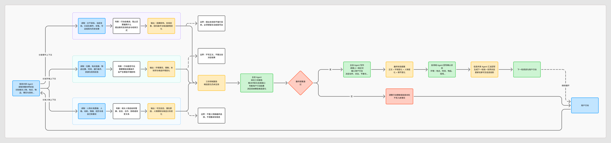

# 互动小说完整 Agent Loop

这份文档描述一轮互动小说从用户行动到下一轮状态的完整写作链路。核心原则是：**信息共享负责把世界资料分发正确，三个领域 Agent 提供分析和候选状态变化，主创 Agent 负责最终裁决与写作，确认后的变化再回写到各领域状态。**

[在 Figma 中查看完整 Agent Loop 详细版](https://www.figma.com/board/bDLUgDFQaZveJfy21Y8YXw/%E4%BA%92%E5%8A%A8%E5%B0%8F%E8%AF%B4%E9%80%9A%E7%94%A8%E5%B7%A5%E4%BD%9C%E6%B5%81%EF%BD%9C%E5%BD%93%E5%89%8D%E9%A1%B9%E7%9B%AE%E5%AF%BC%E8%A7%88?node-id=37-760)



## 一轮写作怎么运转

```text
用户行动
  ↓
共享信息：识别相关人物、地点、物品、事实和剧情目标
  ↓
环境 / 人物 / 情节 Agent 并行分析
  ↓
各自提交领域信息与候选状态变化
  ↓
主创 Agent 综合、解决冲突、决定最终结果
  ↓
主创 Agent 写出下一段正文和最终状态提案
  ↓
环境 / 人物 / 情节 Agent 按确认结果更新各自状态
  ↓
共享信息汇总为下一轮统一世界状态
```

三个子 Agent 的报告在主创确认前都只是候选，不会自动成为世界事实。主创 Agent 是唯一的最终裁决者和写作者。

## 1. 用户行动进入共享信息层

共享信息层维护完整世界记录，但不会把全量资料原样交给每个 Agent。它先理解本轮行动，再沿着行动依赖筛选上下文。

例如用户说“让人物 A 去 B 地找物品 C”，共享信息层会识别出人物 A、地点 B、物品 C，以及“前往—寻找—取得”的行动关系，然后分别整理：环境需要路线和取得条件，人物需要动机与知识，情节需要目标和路线影响。

## 2. 三个领域 Agent 提供支撑并提出候选变化

### 环境 Agent

回答“这个行动在现场是否可行”。它查询人物位置、地点连接、物品位置、通行条件、时间、资源、危险和现场变化，提交已确认事实、限制、相关资源、未知信息，以及可能的环境变化。

它不决定用户是否成功，也不直接移动人物或拿走物品。只有主创提案确认后，环境状态才正式更新。

### 人物 Agent

回答“相关人物会怎样反应”。它查询人物关系网、人格、动机、当前情绪、身体状态、经历、各自知道的事实和近期事件，提交可观察反应、潜在原因、当前意图、禁止行为，以及候选的关系、知识和记忆变化。

它不替人物做最终选择，也不替玩家决定内心。关系图谱可以保留真实关系、人物各自认知和分支历史，但前端只显示玩家有权知道的投影。

### 情节 Agent

回答“这次行动会给故事增加什么可能”。它查询当前主干目标、支线、已发生事件、可达结局和已经使用过的创意，提交因果影响、支线创意、触发原因、后续问题、回归条件和可达结局。

它可以让故事偏离主线，但每条被采纳的支线必须仍然能够到达至少一个合法结局。它提出创意，不直接推进节点，也不写完整剧情。

## 3. 主创 Agent 综合和写作

主创 Agent 收到三份报告后，负责解决冲突并形成唯一的最终提案。它需要判断：

- 用户行动的真实意图是什么；
- 环境条件是否允许行动成立；
- 人物反应是否符合关系和知识边界；
- 情节支线是否有价值且仍可收束到结局；
- 哪些候选状态变化真的发生；
- 本轮正文应该如何承接上一段。

主创输出两部分：

```text
最终正文
最终状态提案
```

正文是用户看到的故事内容；状态提案说明本轮确定发生的环境、人物、关系、知识、剧情和记忆变化。

## 4. 状态回写和下一轮

主创确认后的状态提案交回各领域 Agent：

```text
环境 Agent：更新地点、时间、物品、通道和现场状态
人物 Agent：更新位置、情绪、关系、知识和人物记忆
情节 Agent：更新主线、支线、目标、伏笔和结局可达性
共享信息层：合并三类变化，形成统一的下一轮世界状态
```

如果某个 Agent 在分析中发现了原先没有记录的新内容，它只能提交为“候选事实”。主创采纳后，才能正式写入共享世界状态。

## 5. 信息筛选的基本规则

相关信息不是“同一个地点”或“同一个人物”这么简单，而是要沿行动的前置条件继续展开：

```text
用户想使用 C
→ C 在哪里
→ 谁能取得 C
→ 取得 C 需要什么
→ 当前地点是否可达
→ 取得过程会影响什么人物和剧情目标
```

共享信息层负责把这条依赖链查出来，再把不同领域所需的部分分别交给三个 Agent。这样主创 Agent 收到的是与本轮行动真正有关的信息，而不是整个世界的资料倾倒。

## 6. 当前项目中的边界

- 子 Agent 提供领域分析和候选变化，不直接写正文。
- 主创 Agent 是最终裁决者和唯一写作者。
- 候选变化在主创确认前不是事实。
- 支线可以长期偏离主线，但必须保持至少一个合法结局可达。
- 信息共享层保存完整状态；前端只展示当前玩家有权知道的人物、关系、线索和环境信息。
- 环境、人物、情节三个领域可以各自维护专业状态，但通过共享信息层交换本轮真正相关的内容。

## 7. 一句话理解

**共享信息层负责让大家拿到正确资料，三个领域 Agent 负责从各自角度提出依据，主创 Agent 负责决定故事发生什么并把它写出来，确认后的结果再成为下一轮的世界状态。**

## 8. 这条链路在项目中的落点

当前实现把“信息共享 Agent”落成了一个确定性的共享信息层：它不额外调用模型，也不自行创作内容，而是从当前事件的完整 `stateAfter`、故事包、分支记忆和用户行动生成可追溯的 `sharedContext`。这样每次传给模型的资料都能复现，也不会因为共享层自己猜错而污染世界状态。

对应代码职责如下：

```text
src/story-context.js
  完整世界状态 → 行动依赖筛选 → environment / character / plot 上下文

src/pi-story-runtime.js
  三个领域 Agent 并行报告 → 主创 Agent 裁决 → 正文生成

src/story-engine.js
  校验最终提案 → 原子应用环境、人物、剧情和关系变化

src/story-domain.js
  保存正文、最终提案、三个领域报告和本轮 sharedContext

src/story-store.js
  持久化分支事件、环境状态、人物状态和关系图
```

`candidateChanges` 是三个领域报告新增的候选变化字段。它们会随事件保存，方便审查“Agent 当时建议了什么”；只有主创最终提案中的 `delta`、`storyProgress`、`ending` 和记忆字段会改变正式世界状态。项目用一次原子状态应用完成三个领域的确认回写，再由下一轮 `buildSharedContext` 重新汇总。前端序列化时会返回玩家可见人物的 `relationshipGraph`，隐藏人物和隐藏关系不会泄露。

## 9. 2026-10 重设计：等待体验、质量与可观测

一轮回合按下面的时间线运行（括号内是推给玩家的事件，全部只含玩家有权知道的内容）：

```text
提交行动 ─(start：行动立即回显)
  ├─ 环境 / 人物 / 情节 并行分析 ─(agent_progress)
  │     └─ 环境、人物报告一通过校验 ─(beat：一句感官描写，过滤秘密与私有动机)
  ├─ 主创裁决 → 提案闸门（见第 10 节）─(prepared → scene → outcome)
  ├─ 正文按写作简报流式写作 ─(prose_delta：按完整句)
  │     ├─ [可选] 选项 Agent 与正文并行生成下一步选项 ─(phase: choosing)
  │     └─ 句级守卫：重复句 / 超长立即截停在最后一句完整正文
  ├─ 质量评估：整段重复自动折叠；enforce 模式下过短正文续写一次
  ├─ 连续性记录员读取已发布正文 ─(phase: recording)
  └─ 原子提交：世界状态 + 叙事账本 ─(phase: committing → complete)
```

### 配置（`.ai-novel/pipeline.json` 或环境变量）

| 键 | 默认 | 环境变量 | 作用 |
|---|---|---|---|
| `beats` | `true` | `AI_NOVEL_BEATS=on/off` | 等待期推送感官描写 |
| `outcomeSummary` | `true` | `AI_NOVEL_OUTCOME_SUMMARY` | `outcome` 事件附带结果摘要 |
| `choices` | `inline` | `AI_NOVEL_CHOICES=inline/parallel` | `parallel` 时选项由选项 Agent 与正文并行生成，主创只给 `closingBeat` |
| `narrative` | `enforce` | `AI_NOVEL_NARRATIVE=enforce/advise/off` | 提案闸门的节奏与伏笔校验：`enforce` 不通过时退回主创一次；`advise` 只记录；`off` 不生成写作简报 |
| `recorder` | `agent` | `AI_NOVEL_RECORDER=agent/off` | 正文后由连续性记录员写事实账本；`off` 时只用确定性兜底记录 |
| `quality` | `warn` | `AI_NOVEL_QUALITY=enforce/warn/off` | 正文质量评估的处理方式 |
| `slimContext` | `true` | `AI_NOVEL_SLIM_CONTEXT` | 情节只拿相关原著真相；主创不重复整份共享上下文；正文只收提案投影 |
| `recorderTimeoutMs` | `30000` | — | 记录员超时，超时改用确定性记录，照常提交 |
| `maxResumes` | `5` | — | 正文续写的最大恢复次数，超过后作业失败 |

非法值启动即报错，不会静默回退。原来的审稿 Agent（`critic`）已由连续性记录员取代：它除了修正与正文矛盾的记忆笔记，还负责写入可引用的事实账本。

### 可靠性

- 提交阶段的领域错误（提案无法应用、分支已变化）是永久错误：作业直接 `failed`（`code: COMMIT_REJECTED / BRANCH_CHANGED`），不会再被读者重连反复续写。
- 只有模型请求和文件系统的临时错误才进入 `paused`，并受 `maxResumes` 限制。
- 选项 Agent 连续 3 次校验失败时，用只引用玩家已知目标与线索的确定性选项兜底，并记入遥测。
- 节奏与伏笔问题最多退回主创一次，且不计入 3 次结构化失败上限；仍未修正的问题记为 `narrative_waived` 警告放行，不会让回合失败。
- 记录员失败或超时不阻塞提交：改用只摘录正文原文对白的确定性记录（`fallback_record`）。

### 遥测

每回合的 `telemetry` 写入作业（`job.json`）和存档事件，**不进入玩家事件流**（校验错误可能含隐藏事实 ID）：

```text
{ config, marks: { analyzed, prepared, firstProse, proseComplete, recorded, committed }, totalMs,
  calls: [{ role, phase, durationMs, firstTokenMs, promptChars, toolFailures, autoRetries,
            validationErrors[], usage{...}, model, stopReason, outcome }],
  totals, quality: { issues[] }, record: { source, entries, openedLoops, closedLoops, seedsChecked, contradictions } }
```

对应代码：`src/pipeline-config.js`、`src/turn-telemetry.js`、`src/story-quality.js`、`src/pi-story-runtime.js`（`finishTurn`、`recordTurn`、`generateDeferredChoices`、`playerSafeText`）、`console/performance-view.js`。

## 10. 后半段链路：精准记忆、跌宕节奏与伏笔

从主创裁决到下一轮开始，链路围绕三本**随状态一起分支的账本**运转。它们保存在每个事件的 `stateAfter.narrative` 中，分支和回滚天然带走，不需要额外同步；当前分支的头部状态另存为 `branches/<id>/narrative-state.json` 便于查看。

```text
主创裁决（提案 + dramaturgy + foreshadowing）
  ↓
提案闸门
  ├─ 世界因果：状态变化、阶段推进、推荐行动（必须通过）
  ├─ 节奏曲线：不连续两回合同节拍或同张力、低张力三回合后必须升级、必须有价值翻转
  ├─ 伏笔账本：只能回收已埋下且已在正文露面的伏笔；严重逾期必须处理；结局前全部收束
  └─ 前文呼应：callbacks 只能引用仍有效的账本条目
  ├─ 不成立 → 调整行动 / 结束本轮（不写入新事实）
  └─ 节奏/伏笔未过 → 退回主创一次 → 仍未过则记为警告放行
  ↓
写作简报（beat sheet）：节拍、张力、价值翻转、转折点、结尾悬念、呼应原句、伏笔的表面细节
  ↓
主创写作（只见表面细节，不见伏笔真意，正文不会把伏笔说破）
  ↓
连续性记录员：从已发布正文逐字摘录事实、承诺、伏笔露面情况
  ↓
原子提交：世界 delta + 节奏曲线 + 伏笔状态 + 事实账本 + 未兑现事项，一次写入
  ↓
叙事账本 → 下一轮信息共享层：节奏指令 + 在场伏笔 + 未兑现事项 + 按人物视角裁剪的事实账本
```

### 三本账

| 账本 | 内容 | 谁写 | 谁读 |
|---|---|---|---|
| 张力曲线 `arc` | 每回合的节拍、张力 1–10、价值翻转、转折点、结尾悬念 | 主创（经闸门） | 下一轮的节奏指令 |
| 伏笔账本 `seeds` | 故事包伏笔（玩家得知种子事实即埋下、得知指向事实即回收）与 Agent 新埋伏笔（表面细节、真意、回收设想、回收窗口、强化记录、是否已在正文露面） | 主创埋下/强化/回收/放弃；记录员核对露面 | 情节 Agent 节奏建议、主创裁决、写作简报（仅表面） |
| 事实账本 `ledger` + 未兑现事项 `openLoops` | 从正文逐字摘录的事实（每条带原句 `quote` 和知情人物 `knownByIds`）；承诺、威胁、疑问、计划、人情 | 记录员（引文校验通过才写入） | 主创、情节；人物 Agent 只收到各自亲历的条目；BM25 长期记忆按视角入库 |

### 精准记忆的四道保证

1. **以玩家读到的文字为准**：账本由记录员在正文发布后读取 `published_prose` 生成，提案里有但正文没写的事不入账。
2. **逐字引文校验**：每条账本、每个未兑现事项、每次伏笔露面都必须给出正文中逐字存在的 `quote`，否则工具调用被拒，记录员修正后重交。
3. **视角隔离**：账本条目记录 `knownByIds`（玩家角色自动加入），人物 Agent 和 BM25 角色视角只拿到自己亲历或被告知的条目，同场不自动共享秘密。
4. **可取代而非覆盖**：后来的事实改变旧事实时，旧条目标为 `superseded` 并保留来源，`callbacks` 不能引用已被取代的条目。

### 跌宕与伏笔的规则

- 节奏指令由程序根据张力曲线确定性计算：同一节拍连续两回合、张力连续两回合持平、低张力（≤4）连续三回合属于**硬性约束**；连续顺利成功、高压持续、张力单调上升、高潮/后果阶段、伏笔到期或逾期、承诺悬置三回合以上属于**建议**。
- 每个非拒绝回合必须给出价值翻转（`valueShift.from ≠ to`），没有翻转的回合不成立。
- 转折点必须来自已有人物动机、已埋伏笔、未兑现事项或世界规则；情节 Agent 的 `pacing.twistIdeas` 也受同一约束。
- Agent 新埋伏笔同时在场不超过 5 条；埋下后正文没露面的伏笔要先强化才能回收；超过回收窗口 2 回合且 2 回合没被触碰即为严重逾期，闸门要求本回合处理。
- 主线伏笔（故事包 `foreshadows`）只有在玩家角色真正得知它指向的事实时才算回收，不能只在提案里宣称。
- 推荐选项至少一项直接回应本回合的结尾悬念；有悬置的承诺、威胁或疑问时，给玩家去兑现、追问或化解它的选择。

### 控制台

工作流画布的后半段对应上面的链路：提案闸门（四项检查与退回次数）→ 写作简报 → 主创写作 → 连续性记录 → 原子提交 → 叙事账本，叙事账本用虚线回流到下一轮的信息共享。点开「叙事账本」节点可看到张力曲线、伏笔账本（含真意，作者视角）、未兑现事项和事实账本；「原子提交」的状态差异只显示世界状态，账本变化在「叙事账本」中查看。

对应代码：`src/story-narrative.js`（账本、节奏指令、闸门、写作简报、记录校验与兜底）、`src/story-engine.js`（`applyTurnProposal` 调用 `applyNarrativeProposal`）、`src/story-domain.js`（`appendTurn` 原子写入记录）、`src/story-context.js`（`narrativeDigest`）、`src/memory/cards.js`（账本与未兑现事项入 BM25）、`console/narrative-view.js`。
